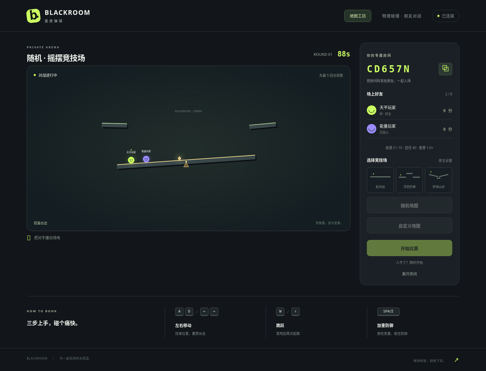
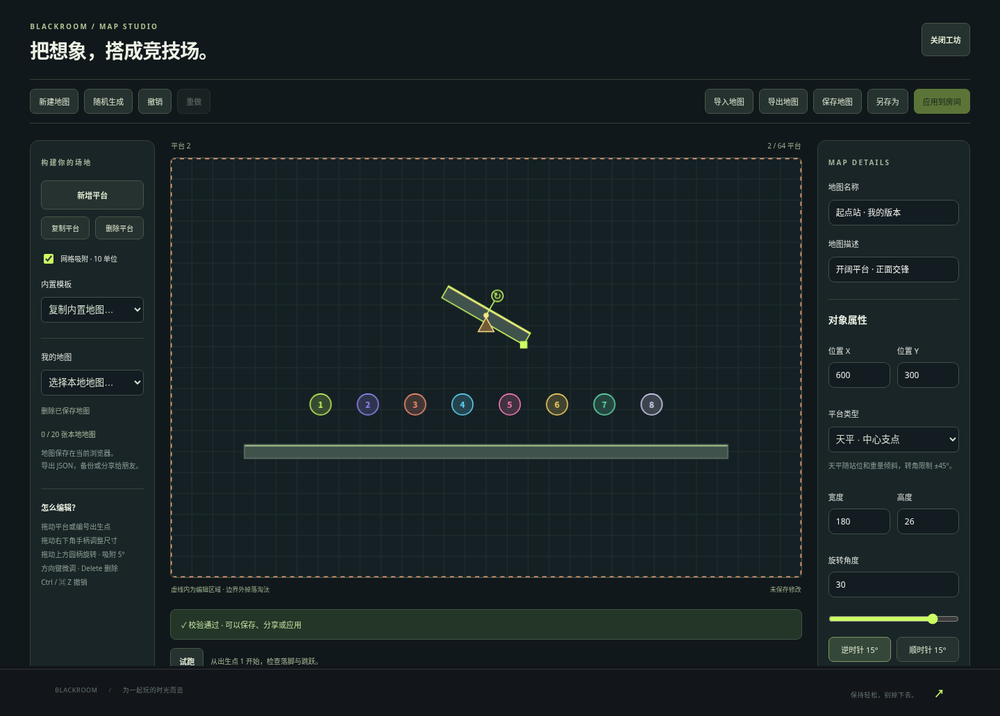

# 随机地图与能量天平交付验证

日期：2026-10-12。分支 `work`；对应能量天平设计与实施计划。

## 已执行并通过

| 检查 | 结果 |
| --- | --- |
| `npm run typecheck` | 通过 |
| `npm test` | 14 个测试文件，74 项测试通过 |
| `npm run build` | 前端和服务端构建成功 |
| Node 生产浏览器验收 | 11 项 Chromium 测试通过 |
| Docker 多阶段构建与 Compose | 构建成功，`blackroom-energy` 服务 healthy |
| Docker 应用冒烟 | 健康、HTML/静态资源、双人 WebSocket 加入/开局/移动/离开通过 |
| Docker 浏览器验收 | 同样 11 项测试通过 |
| `git diff --check` | 通过 |

最终镜像：`sha256:38924b6b5e368fbb2d9b94160c12c4651e63003eb2f418bd1b65dd7150adce92`。验收使用本机 Node 端口 3092 与 Docker 端口 3093，非公开部署链接。Docker 使用已有代理与临时 CA secret，保持 TLS 校验，不使用 host 网络。

## 验证覆盖

- 200 个生成种子的格式/几何校验；40 个种子真实物理中八人初始安全落脚；独立审查另检查 20,000 个种子。
- 能量下落、落地停留、寿命、仅活玩家拾取、同时触碰仅奖励一人、十层上限；真实半径/质量增长及空格四倍质量切换。
- 不平衡/较重单侧载荷让天平倾斜、对称载荷平衡、固定地面静止、中心支点稳定和 ±45° 限角。
- Match 新回合清除旧能量和成长；平台角度/能量位置插值、收集后移除、换轮清理。
- 实际 WebSocket 验证房主随机图、访客拒绝、后加入同步、开局后不可更换、包含真实平台/能量/半径/质量的快照。
- 浏览器实际拖动旋转手柄、顺逆时针、滑杆、撤销、平台类型、JSON 导出和试跑；原有保存/拖动/配额/断线/联机计分流程保留。

## 审查修复

浏览器复现旧 localStorage 缓存导致跨窗口串行写入仍丢数据，新增确定性缓存回归先失败后通过：事务中保留最新地图库内容，后续保存/删除在该版本上进行。

独立审查发现一个 Important：更新前仍打开的旧窗口不维护新事务记录，可能覆盖新作品。浏览器回归确认旧写入者仍能打开数据库，再将数据库升级为版本 2；回归通过，已有旧地图保留，旧写入者收到 VersionError，刷新后可继续保存。无 Critical；该 Important 已修复。

两项 Minor 暂留：旧版固定平台地图导出仍保持版本 1，两种版本均可读取；旋转滑杆没有独立的窗口失焦收尾，通常由控件失焦提交，审查未确认用户可见的撤销错误。

首轮 Docker 浏览器失败来自测试在创建房间响应前读取空房间码，已改为等待房间码及加入成功后继续；排查时并行浏览器任务的输出文件冲突也已避开，最终串行完整套件通过。

## 实际截图

截图来自最终 Docker 应用的真实浏览器验收。

## 使用范围

所有地图开局 1 秒后启动能量雨，之后每 3 秒一个；每次半径 +2，最多十层、半径 40，每轮重置。随机图在本场各轮保留，准备阶段由房主重新生成。地图本地保存和 JSON 分享继续支持；更新前打开的窗口需刷新后保存。本次未做长期玩法平衡或公网并发容量测试。
