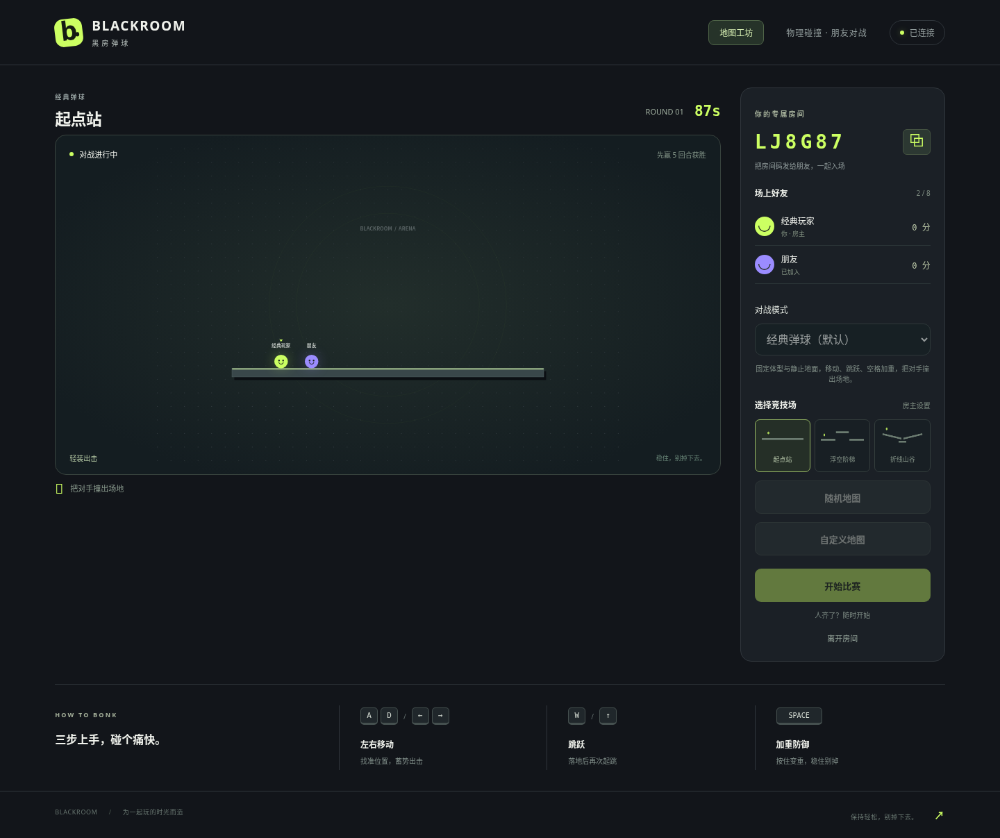

# 经典与能量模式修订验收

日期：2026-10-12。用户修订要求：新增玩法保留为可选模式，恢复原来的玩法作为默认。

## 最终行为

新房间默认 **经典弹球**：固定体型、静止地面、原有移动/跳跃/空格加重和五回合制胜；不生成能量。房主在准备阶段可以选择 **能量天平**，开启能量雨、成长和动态天平。访客仅查看，模式同步给后来加入者；开始比赛后锁定，换地图不切换模式，房主离开或返回准备页保留已选模式，新房间独立默认经典。

地图数据独立于模式。经典模式将天平按静止平台处理，不删除原始 motion 字段；切换回能量模式后恢复天平物理。随机地图按当前模式生成固定或动态平台，工坊保留旋转手柄、角度控件和平台类型编辑。工坊有独立试跑模式，默认房间模式或首页经典；试跑选择不会隐式改变房间模式。

## 已通过检查

- `npm run typecheck`：通过。
- `npm test`：15 个测试文件，79 项通过。
- `npm run build`：前端和服务端构建成功。
- Node 生产浏览器：12 项测试通过。
- Docker：镜像构建成功，Compose 服务 healthy；健康/静态资源/双人 WebSocket 冒烟和同样 12 项浏览器验收通过。
- `git diff --check`：通过。

最终 Docker 镜像：`sha256:cb54f9035315651e1ea9c9614d31a93ed89d1f5b1f7805f5167e1da55587da19`。Node 验收端口 3094，更新后的 Docker 验收端口 3093，仅为本机测试地址。

新回归先在旧版本失败，再验证默认无能量和成长、静止天平且保留地图属性、模式消息格式与权限、后加入同步、开局锁定和房主转移。浏览器实际运行经典模式超过 2.5 秒，确认零能量/零动态平台/固定半径；并验证显式能量模式、独立试跑和原有对战计分流程。经典地面配置恢复原来的摩擦参数 .15，Matter.js 静态刚体运行时摩擦为 1，与原始版本一致。

## 实际截图

## 独立审查

独立审查未发现 Critical、Important 或 Minor 问题。另执行 20 项针对性测试及生命周期验证，确认进行中的房主转移、能量模式重赛、准备页切回经典、新房间默认值和自定义地图属性保留。未改动文件。
